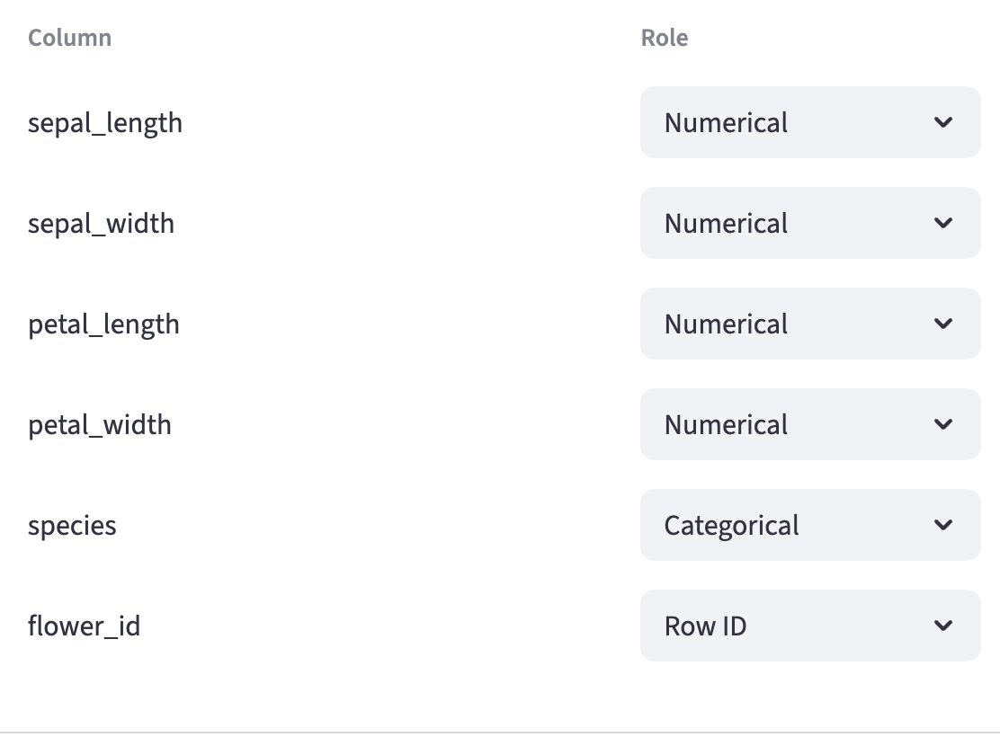
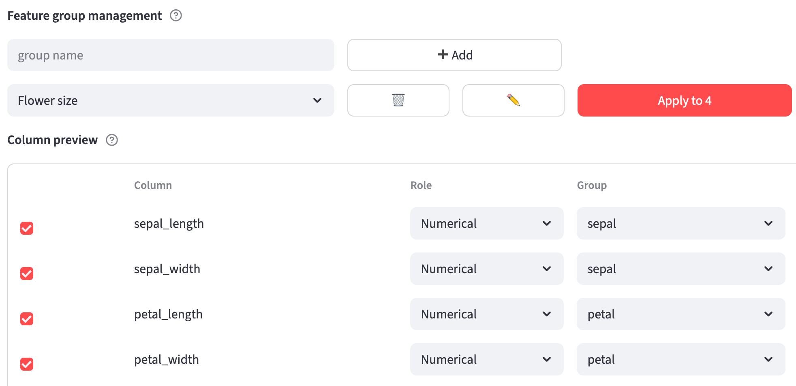
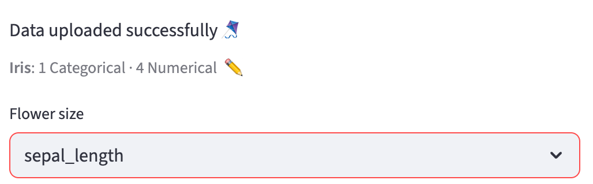

# Configuration {#sec-data-analysis-config}

Every upload, including a Data Extraction table, uses the same column editor. Analysis opens immediately when detected or saved column choices are valid. Review is optional; apply changes to one upload or save them as a reusable profile.

This walkthrough uses [iris.csv](analysis_ui_shots/iris.csv), a table of **150 flowers and six columns**.

## 1. Upload Iris {.unnumbered}

Upload `iris.csv` on **Data Analysis**. The app reuses a saved profile if exactly one matches the complete header set; otherwise, it detects roles and groups automatically.

Click **✏️** beside the upload summary to open the column editor. The summary shows **Auto-detected** or the applied profile's name. If a column needs attention, such as an assigned ID with repeated values, the editor opens automatically.

For your own data, use column names on the first row and one observation per row. The uploader accepts CSV, TSV/TXT with tab, semicolon, or pipe separators, Excel `.xlsx`/`.xlsm`, and OpenDocument `.ods`. Put a spreadsheet's table on its **first sheet**.

## 2. Review column roles {#id-config .unnumbered}

The editor reports **6 columns × 150 rows**. Each column has one **Role**: **Row ID**, **Categorical**, **Numerical**, or **Ignore**. See [Column roles](data_analysis.qmd#column-roles) for their uses and requirements.

For Iris, keep the four length and width columns **Numerical**, set `species` to **Categorical**, and assign `flower_id` as **Row ID**:

{width=70% fig-align=center fig-alt="Role dropdowns assign sepal_length, sepal_width, petal_length, and petal_width to Numerical, species to Categorical, and flower_id to Row ID."}

Use each column's **Role** dropdown to change its use. For example, a numeric treatment code can be Categorical so it appears in filters. Changing a column away from Numerical removes its feature-group assignment.

::: {#identifiers-config}
A **Row ID is optional**. Automatic suggestions use exact identifier names from extraction profiles, such as `cell_id`; you can assign another column manually. Only one column can be Row ID, and its values must be nonmissing and unique. Assigning a new ID returns the previous ID column to Numerical or Categorical according to its values.

With no assigned ID, the app adds **Row number**, populated with `1` through the number of input rows. If that header already exists, it uses `Row number.1`, then `.2`, and so on. These labels follow input row order, so use your own identifier when identity must remain stable across reordered files. For Iris, change `flower_id` to **Ignore** to use generated row numbers.
:::

::: {#categorical-feature-config}
At least one **Numerical** column must contain usable numbers. Field-of-view columns such as `image_name` use the **Categorical** role in every upload. Categories are stored as text; whole-number labels use `1` rather than `1.0`, and missing values become `N/A`.
:::

## 3. Feature group management {#feature-group-management .unnumbered}

**Feature group management**, above **Column preview**, organizes Numerical columns into shorter picker lists without changing their values. Unassigned measurements appear under **Uncategorized Features**. Feature groups organize measurements; categorical columns group or filter observations.

### How group names are inferred {.unnumbered}

Recognized extraction headers form groups by extractor and channel, such as **Lifetime fit_nadh**. Columns beginning with `Derived: ` form **Derived Features**. These rules apply to any uploaded table.

For other headers, at least two new Numerical columns must share the prefix before the earliest `_`, `.`, or `: ` (colon and space) to form a new group:

| Column headers | Suggested group |
|---|---|
| `sepal_length`, `sepal_width` | **sepal** |
| `petal_length`, `petal_width` | **petal** |
| `NADH.mean`, `NADH.std` | **NADH** |
| `Texture: contrast`, `Texture: entropy` | **Texture** |

Hyphens stay within names: `anti-PD1_mean` and `anti-PD1_std` form **anti-PD1**. Saved assignments are preserved, including renamed groups and ungrouped columns. New columns can follow matching saved columns into their group or join an existing group with the matching name.

### Change groups in bulk {.unnumbered}

Keep the suggested **sepal** and **petal** groups, or combine the four measurements into **Flower size**:

1. Type `Flower size` in **Group name** and click **➕ Add**.
2. Tick the Numerical columns to move. For Iris, **Select all** selects all four measurements.
3. Choose **Flower size** in the group dropdown, then click **Apply to 4**.

{width=100% fig-align=center fig-alt="Feature group management has Flower size selected and Apply to 4 enabled. All four Iris measurements are ticked; their current groups are sepal or petal."}

For one feature, change its row's **Group** directly. To remove assignments, choose **Uncategorized**. To rename a group, select it, enter a new **Group name**, and click **✏️**; using an existing name merges the groups. **🗑️** deletes the group and leaves its measurements uncategorized.

## 4. Use or save your choices {.unnumbered}

- **Use for this upload** applies the reviewed roles and groups without changing saved profiles.
- **💾 Save profile as** stores a new profile and resumes analysis. When starting from detected columns, enter `Iris` beside this button to reuse these choices later.
- **💾 Save to {profile} & use** appears when a saved profile is applied. It updates that profile and resumes analysis.

If the name entered beside **Save profile as** already exists, confirm with **⚠️ Replace profile** or enter another name. Column edits take effect only when you choose Use or Save.

## 5. Reopen the column editor {.unnumbered}

Select **sepal_length** from **Flower size** to begin analysis, or from **sepal** if you kept the automatic groups.

If you saved the example as Iris, the summary reads **Iris: 1 Categorical · 4 Numerical**; counts omit the optional Row ID. Click **✏️** beside it to reopen the editor.

{width=70% fig-align=center fig-alt="Iris: 1 Categorical · 4 Numerical appears beside a pencil button. The Flower size picker has sepal_length selected."}

Temporary edits show **This upload only**, or **{profile} · edited for this upload** when based on a saved profile. Reopening hides the analysis controls and plots while preserving their settings.

Choose **Use for this upload** or Save to apply further edits. **Cancel** restores the choices in use before reopening, including earlier upload-only edits, and resumes analysis.

## 6. Reuse and manage saved profiles {.unnumbered}

Automatic profile matching requires exactly one match to the **complete header set**, including columns marked Ignore. Case, spaces, and punctuation matter; column order does not. Otherwise, the app detects roles and groups.

Inside the editor, **Apply a saved profile (optional)** lists related profiles with **shared**, **missing**, and **new** column counts. Applying one replaces the current draft and keeps the editor open. It preserves saved roles and groups for present columns and guesses new ones. Saving back to that profile records new columns and removes absent ones.

Expand **Manage saved profiles** below the action buttons to rename (**✏️**) or delete (**🗑️**) any saved profile. These changes take effect immediately; Cancel only discards column and group edits. Deleting the profile supplying the draft resets it to automatic detection.

You can store **20 profiles**. At the limit, replace an existing profile or delete one before saving another.
