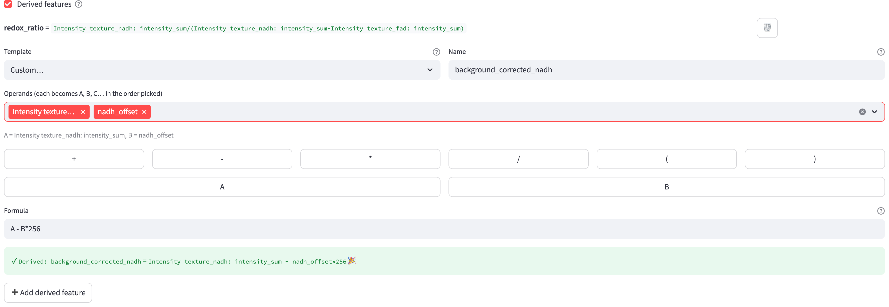

# Derived Features {#sec-derived-feature}

**Derived features** combine existing features, including features from different channels. For example, the normalized optical redox ratio uses the `intensity_sum` from two channels: NAD(P)H / (NAD(P)H + FAD).

## Build Derived Features

Select `Derived features` near the bottom of the [Configuration](#sec-data-extraction-config) page to open the builder.

{width=100% fig-align=center fig-alt="A saved redox_ratio definition above a custom background_corrected_nadh formula, A minus B times 256, using NADH intensity_sum and nadh_offset as operands."}

Any derived features already defined for the current profile are listed at the top, each showing its name, its expanded formula, and a `🗑️` button to delete it. Below the list, a new feature is composed from:

- a `Template` (a common formula, or `Custom…` to write your own),
- a `Name` (`e.g. redox_ratio`) — the output column becomes `Derived: <Name>`, and
- the operands that fill the formula.

::: {.callout-note collapse="true" }
# Not finding the features you expect?
Operands are available from all channels. If none are listed, select [feature extractors](data_extraction_config.qmd#feature-extractor) for your channels first, then return to the builder.

Each operand dropdown lists categorized features first, followed by bookkeeping columns without an extractor prefix: `amp1`, `offset`, `reduced_chi_square`, centroid coordinates, and the `a2` / `a3` fit remainders. These are per-cell numbers and can be used like any other operand.

For example, background-corrected intensity is `Intensity texture_<channel>: intensity_sum` minus `<channel>_offset` times the number of time bins. Enter the bin count as a number in `Custom…` mode, e.g. `A - B*256`.

A pixel-prefitted (SPCImage) channel does no fit of its own, so it contributes only its `a2` / `a3` remainder — no `amp`, `offset` or `reduced_chi_square`.
:::

When the preview is valid, click `➕ Add derived feature`. Each [extraction profile](data_extraction_config.qmd#extraction-profiles) keeps its own definitions; adding or deleting them saves the change immediately.

### Templates

The `Template` dropdown offers four ready-made formulas: normalized `A / (A + B)`, ratio `A / B`, difference `A - B`, and sum `A + B`. Each fills in the formula and provides searchable dropdowns for operands `A` and `B`.

Pick both features and give the result a `Name`, then check the live preview. The fifth option, `Custom…`, opens the formula editor described next.

### Custom Formulas

`Custom…` mode lets you compose an arbitrary formula. First pick the operands from the `Operands (each becomes A, B, C… in the order picked)` multiselect — the features you choose are aliased `A`, `B`, `C`, … in pick order, and a caption echoes the mapping (e.g. `A = Intensity texture_fad: intensity_sum,  B = …`). Then build the formula in the `Formula` box, typing directly or using the append buttons for the operators (`+ - * / ( )`) and for each alias.

The formula language supports:

- the four arithmetic operators `+`, `-`, `*`, `/`,
- a leading sign (unary `+` / `-`),
- numeric constants, and
- parentheses for grouping.

Division by zero yields `NaN` rather than raising an error or producing infinity. Anything outside this language — function calls, exponentiation (`**`), modulo (`%`), comparisons, or a bare operand with no operator — is rejected.

## Compute Derived Features

Derived features are computed during [Numerical Feature Extraction](#sec-numerical-feature-extraction), after the successful FOV results have been concatenated. The definitions from the active extraction profile are recorded in the automatically saved FOV metadata alongside the extraction settings. Each definition adds one `Derived: <name>` column to the output dataset.

If any cell has `NaN` in a derived column, for example after division by zero or use of a `NaN` operand, a single dataset-wide warning reports the affected cell count for that feature. These cells remain in the output.

## Derived Feature In Data Analysis

On the [Data Analysis](#sec-data-analysis) page, all derived features are collected into one `Derived Features` group in the [numerical selection widgets](data_analysis.qmd#numerical-selection-widgets), alongside the per channel-extractor groups. A derived feature is labeled by its plain name (e.g. `redox_ratio`); unlike extracted lifetime or intensity features, it carries no unit or symbol, since its meaning is entirely user-defined.
