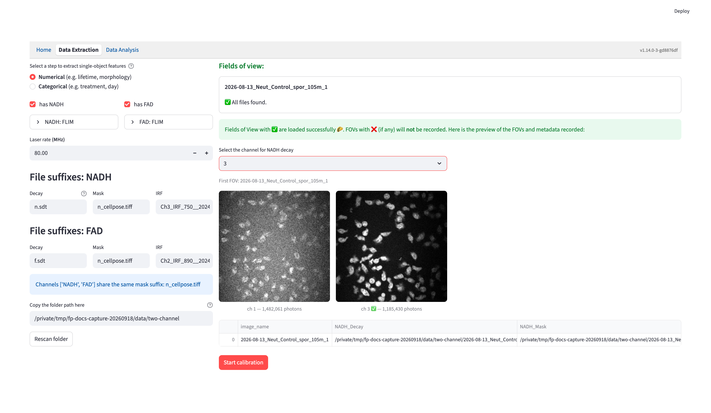
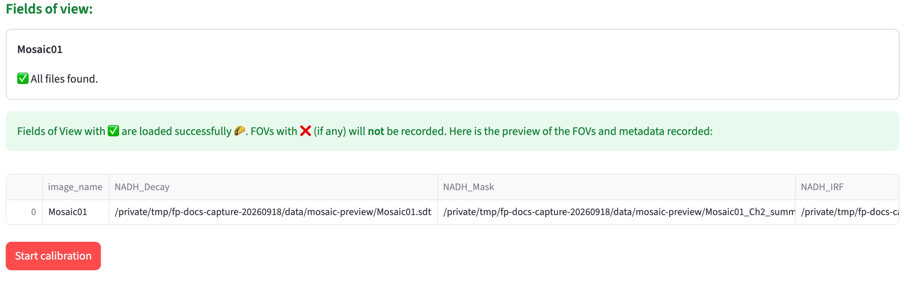

# Field of View Metadata {#sec-fov-metadata}
FOV metadata record each field of view's file paths, acquisition information, calibration settings, and selected extractors. The **Data Extraction → Numerical** workflow prepares and automatically saves this record.

::: {#fov-metadata}
{width=100% fig-align=center fig-alt="Numerical source preparation with channel and folder settings on the left and field-of-view checks and a metadata preview on the right."}
:::

The left side contains source settings from the active [extraction profile](data_extraction_config.qmd#extraction-profiles); the right side shows file validation, any required channel assignments, and the metadata preview. After preparation, the source settings remain available in the collapsed **Metadata settings** expander.

## Source settings

Source edits, a rescan, or a profile change invalidate an already prepared workflow, so the app repeats preparation before extraction. If another browser tab changed Configuration, follow the reload notice to use its new settings.

### Folder Path
Enter the path to the folder containing the required input files. The scan includes subfolders.

## Metadata Extraction
### FOV File Paths

The app finds files matching the first configured per-FOV suffix, excluding calibration suffixes, then derives each FOV name:

- FOV name = file name - 1st file suffix

It finds the remaining inputs using:

- File name to search = FOV name + configured file suffix

Calibration files are shared across FOVs and are searched for by suffix alone, independently of the FOV name. For example, the same `standard.ptu` or `irf.ptu` will be used for every FOV in the folder. Files matching configured IRF or fluorescence lifetime standard suffixes are excluded from FOV discovery, even when they share the sample's `.ptu` extension. This also applies to configured references for an inactive calibration method; those files are excluded if present but are not required.

Each FOV card reports whether the required inputs were found:

- **Missing:** no file matches the expected FOV name plus suffix, or no calibration file matches its suffix.
- **Duplicate:** multiple files match a calibration suffix, or the same per-FOV filename appears in different subfolders. Keep one unambiguous match for each required input.

FOVs marked ✅ are included in the metadata; FOVs marked ❌ are excluded.

::: {.callout-tip}
After correcting missing or duplicate filenames or changing the folder path, click `Rescan folder` to repeat the scan.
:::

### Decay Info {#metadata-decay-info}

For [3D/4D decay](data_extraction_config.qmd#three-d4d-decay), FLIM Playground tries to infer the `duration` and number of `time bins` per laser pulse interval from the file metadata. It also checks for inconsistencies across decay files.

#### Channel Assignment

For a 4D decay array, FLIM Playground lists the non-empty acquisition channels for each configured channel name. If only one is available, it is assigned automatically; otherwise, select the intended channel.

The app also checks dimensions across FOVs and channels within each imaging modality. FLIM, intensity-only, and QPI modalities can have different spatial grids, provided each image matches its own mask; corresponding cells are joined by label.

Intensity-only and QPI TIFFs can hold several channels too. They are assigned the same way. Channels that are empty in every field of view are not offered, and a field of view whose channels are all empty is rejected. Z-stacks, time series, complex-valued images and files with more than one axis besides the image channels are rejected.

When several channels are available, a preview below the dropdown shows one thumbnail per candidate from the first FOV, with a ✅ on the selected channel. Check that it looks like the fluorophore you expect.

The metadata records the standard's file path, known lifetime, and time axis. For a PTU standard, the app supplies the time axis automatically from the integrated reference curve.

### Result preview and automatic save

When at least one FOV has valid inputs and the applicable acquisition and reference checks pass, inspect the metadata preview. Click **Start calibration** if any selected channel needs IRF shift or QPI background calibration; otherwise click **Start extraction** to begin extracting immediately. Both actions automatically save the metadata in the source folder.

{width=100% fig-align=center fig-alt="Numerical source validation with field-of-view status, a metadata preview, and the next workflow action."}

For example, a two-channel FLIM experiment records:

- `image_name`: each FOV's name, when `image_name` is the configured [FOV identifier](data_extraction_config.qmd#fov-identifier).
- `nadh_Mask`, `nadh_Decay`, `nadh_IRF`, `fad_Mask`, `fad_Decay`, `fad_IRF`: the [file paths](#fov-file-paths) of the mask, decay, and IRF files for the `nadh` and `fad` channels. 
- `nadh_input_type`, `nadh_imaging_modality`, `fad_input_type`, `fad_imaging_modality`: the [imaging modality](data_extraction_config.qmd#imaging-modality) and the corresponding input type for each channel. These are two distinct values. For a channel whose modality is `FLIM`, the input type is one of the [decay types](data_extraction_config.qmd#decay-types); for a channel whose modality is `Intensity-only`, the input type is `Intensity (2D)`; for `QPI`, it is `QPI (2D)`. Channels that share the same imaging modality share the same input type.
- `nadh_Lifetime fit free`, `nadh_Intensity morphology`, `nadh_Lifetime fit`, `fad_Intensity morphology`, `fad_Intensity texture`, `fad_Lifetime fit`: [feature extractors](data_extraction_config.qmd#feature-extractor) for each channel.
- `nadh_channel`, `duration`, `fad_channel`, `time_bins`, `laser_rate`: the [recorded decay info](#metadata-decay-info) for each channel and information shared by all channels.

For [QPI](qpi.qmd) channels, the record also includes the OPD-image and mask paths, physical constants (`pixel_size_um`, `opd_unit`, and `alpha_um3_per_pg` with the channel prefix), and the confirmed background recipe. Spatial dimensions are recorded separately for each modality.

Preparation writes `fov_metadata_<timestamp>.csv` into the source folder. Confirming calibration and changing the confirmed fitting mode automatically update the same file. A failed metadata write shows **Retry saving metadata** and prevents feature extraction until saving succeeds. This CSV records the run for bookkeeping and troubleshooting; new runs begin from the source folder in [Numerical](numerical_feature_extraction.qmd#sec-numerical-feature-extraction).
